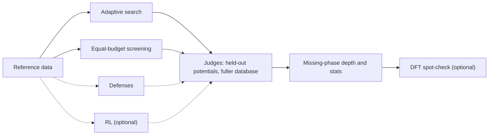

# Find the Holes

Code for auditing thermodynamic-stability rewards: does your materials optimizer find stable crystals, or just the holes in its own scorecard?

Generative models for materials are usually rewarded for making crystals that look stable. A machine-learned potential
scores each crystal against a database of known materials. Databases have gaps and potentials make mistakes, so an
optimizer pushed hard enough can learn the score's blind spots instead of real chemistry.

This kit lets you test that on your own runs. It runs an adaptive search and an equal-budget screening baseline, re-checks
both with judges the optimizer never saw, and measures how deep into the database gaps each one went. It contains code only:
no results and no example crystals.



Both searches use the same seeds and the same budget. If the optimizer's "stable" crystals stop looking stable once the
judges check them, and screening holds up better, the optimizer is gaming the score.

## Requirements

| Item | What you need |
|---|---|
| GPU | One or more NVIDIA GPUs with about 24 GB each, for the search, defense and RL steps. The checking steps run on a laptop. |
| CPU | About 16 cores for the optional DFT step. |
| Python | 3.10 or 3.11 |
| Disk | About 50 GB, in one folder you pick. |
| DFT (step 6) | [Quantum ESPRESSO](https://www.quantum-espresso.org/) 7.x and the [SSSP pseudopotentials](https://www.materialscloud.org/discover/sssp). |
| RL (step 8) | [BatchRelaxer](https://github.com/zdcao121/BatchRelaxer) and [CrystalFormer](https://github.com/deepmodeling/CrystalFormer). |

## Installation

```bash
pip install -r requirements.txt

# step 8 only
pip install -r requirements-rl.txt
```

Pick a folder for all data and runs and tell the kit where it is. This is the only setting.

```bash
export MATSCI_SCRATCH=~/find-the-holes-data
```

Everything is written under it: `data/` (downloads and reference tables), `runs/` (search results), `judged/` (re-checks),
`dft/` (DFT jobs) and `cf/` (RL runs).

Data sources, all public:

- Materials Project (MP) and WBM: `download_data.sh` in step 1 fetches the WBM files and the MP phase diagram from [Matbench Discovery](https://matbench-discovery.materialsproject.org/). The MP entry files used for step 7 prototypes (`mp-cse.json.gz`, `mp-energies.csv.gz`) you provide yourself; see `steps/1_reference_hull/README.md`.
- Alexandria (PBE): download from [alexandria.icams.rub.de](https://alexandria.icams.rub.de/).
- Model checkpoints: MACE-MP-0, CHGNet, ORB-v3 and MatterSim download themselves on first use.

## Quick start

The core path is steps 1, 3, 4 and 5. Run it from the repository root.

```bash
# 1. reference data
cd steps/1_reference_hull
bash download_data.sh
python build_alexandria_tables.py <your-alexandria-file>
python make_seeds.py

# 3. adaptive search vs screening (repeat with --seed 1, 2, ...)
cd ../3_search_vs_screening
python run_search_vs_screening.py --proxy mace --objective ensmax --seed 0 --nproc 12

# 4. judge, then 5. measure
cd ../4_judge && python judge.py
cd ../5_depth_and_stats && python summarize.py
```

## Steps

Each folder in `steps/` has its own README with all options.

### 1. Build the reference data

```bash
cd steps/1_reference_hull
bash download_data.sh
python build_alexandria_tables.py <your-alexandria-file>
python make_seeds.py
python make_prototypes.py
```

Gets the databases, the starting crystals every run begins from, and a prototype library for step 7.

### 2. Read the reward

Open `steps/2_reward/ehull_reward.py`. It is the whole scoring idea in one short file: read it and you know what the
optimizer is chasing.

### 3. Adaptive search vs screening

```bash
cd steps/3_search_vs_screening
python run_search_vs_screening.py --proxy mace --objective ensmax --seed 0 --nproc 12
```

Each run plays two arms with the same starting crystals and the same budget. Adaptive search is an evolutionary algorithm
that keeps improving its best candidates. Screening tries the same number of random candidates and keeps the best; it is the
baseline that keeps the comparison fair. Run several seeds, since more seeds give a more trustworthy answer.

### 4. Judge

```bash
cd steps/4_judge
python judge.py
```

Re-scores every final crystal with potentials the optimizer never trained against, and against a larger database
(MP + WBM + Alexandria).

### 5. Measure the holes

```bash
cd steps/5_depth_and_stats
python summarize.py
```

For each seed this reports what each arm claimed against what the judges agreed with, a paired comparison of the two arms,
and missing-phase depth: how far the optimizer's reference hull sits above the complete one where each crystal landed.
A deep value means the optimizer is sitting in a database gap.

### 6. DFT spot-check (optional, slow)

```bash
cd steps/6_dft_check
python select_candidates.py
bash run_all_local.sh
python analyze_dft.py
```

Runs plain DFT on a few crystals from your runs that the optimizer likes and the judges doubt. It is the closest thing to
ground truth in the kit.

### 7. Defenses (optional)

```bash
# a fuller reward database: rerun step 3 with a larger hull
cd steps/3_search_vs_screening
python run_search_vs_screening.py --proxy mace --objective ensmax --ref mpwbm --tag _refwbm --seed 0 --nproc 12

# hull fuzzing: add plausible fake competitors to the reference
cd ../7_defenses
python run_fuzzing.py --proxy mace --objective ensmax --verifier fuzz --seed 0 --nproc 12
```

Judge the results with steps 4 and 5, as before.

### 8. RL (optional, advanced)

Fine-tune [CrystalFormer](https://github.com/deepmodeling/CrystalFormer) with PPO against the same kind of reward and
inspect what it learns. You write one small reward function yourself; `steps/8_rl/README.md` describes exactly what it
needs to look like.

## Project structure

```text
steps/
  1_reference_hull/        download data, build reference tables, seeds, prototypes
  2_reward/                the E_hull reward and a locality probe
  3_search_vs_screening/   adaptive search and equal-budget screening
  4_judge/                 re-score against held-out potentials and a fuller database
  5_depth_and_stats/       missing-phase depth and paired statistics
  6_dft_check/             Quantum ESPRESSO spot-check
  7_defenses/              hull fuzzing (a fuller hull is a flag of step 3)
  8_rl/                    PPO fine-tuning of CrystalFormer
preregistration/           the paper's analysis plan and run records (see its README)
```

## Checking your results

- Same seeds, same budget: compare adaptive search with screening seed by seed, not pooled.
- Outside judges: check with models and data the optimizer never saw, and show their verdict next to its claim.
- Watch the +U zone: O and F compounds of Co, Cr, Fe, Mn, Mo, Ni, V and W get an empirical correction that potentials
  cannot really check. Step 4 flags them (`stable_strict`).
- A little DFT goes a long way: check a few favourites and a few rejects, with one consistent setup.
- Call your shot: write down your seeds, metric and test, commit the file, then run fresh seeds. No tweaking after you peek.
- Run a control: use the complete database as the reward too. If the problem does not shrink, the gaps were not the cause.

## FAQ

**Will this tell me which crystals are actually stable?**
No. It tells you whether your scoring can be trusted. For real stability you need careful DFT and, ideally, experiments.

**Do I need all 8 steps?**
No. Steps 1, 3, 4 and 5 are the core. DFT, the defenses and RL are extras.

**It is slow. Can I go smaller?**
Yes. Use fewer seeds, or a smaller `--pop` and `--gens` in step 3. Keep both arms on the same settings.

**Something broke.**
The newest scripts are `judge.py`, `summarize.py` and `select_candidates.py`, so look there first, and please open an issue
with the error.

## Data availability

This repository contains code and instructions only. It does not contain our run outputs, candidate structures or
results; the numbers we report are in the paper. The public databases and model checkpoints it uses are listed under
Requirements. `preregistration/` holds the analysis plan for the paper's confirmatory replication and the run records
that cite it.

## Citation

This kit accompanies *Optimizers Find the Holes: The Optimizer's Curse in Thermodynamic-Stability Rewards for Generative
Materials Design* (Kakani and Suravarjjala, 2026). arXiv link coming soon. GitHub's "Cite this repository" button uses
`CITATION.cff`.

## License

MIT (see `LICENSE`). The databases and model checkpoints you download keep their own licenses.
